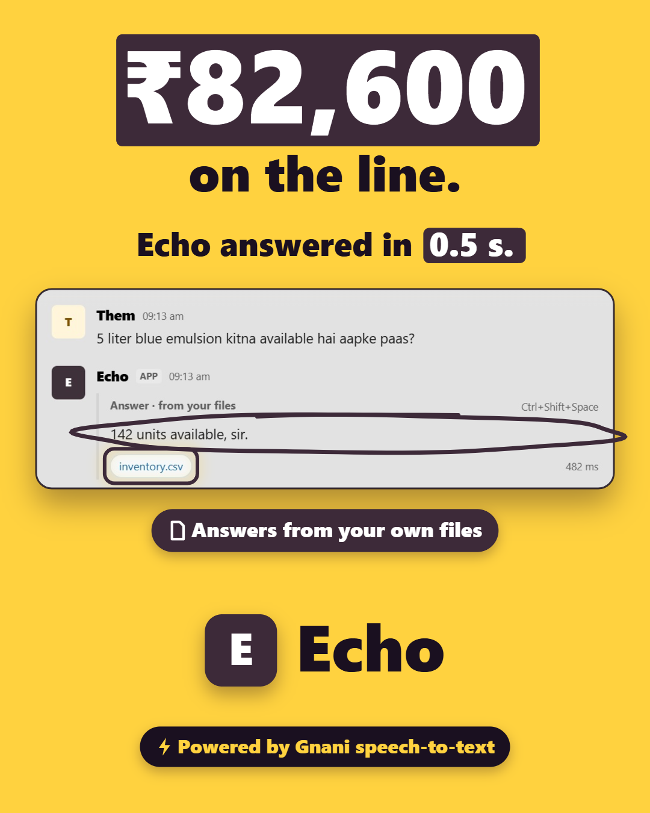
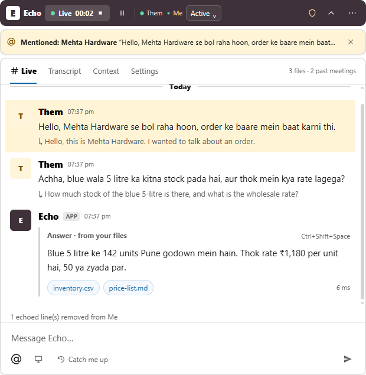
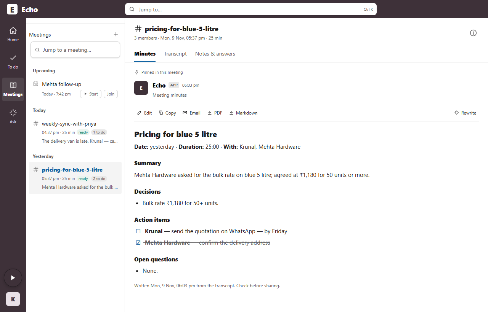
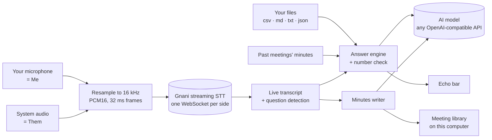

# Echo — the meeting buddy that knows your work

**Echo listens to your calls in Hindi, Hinglish and other Indian languages, answers your
client's questions from your own files while you talk, and writes the minutes when you
hang up.** Powered by **Gnani speech-to-text**.

<p align="center">
  <a href="https://youtube.com/shorts/KDxG8_bf3q0" title="Watch the Echo demo video">
    
  </a>
  <br>
  <strong>▶ <a href="https://youtube.com/shorts/KDxG8_bf3q0">Watch the demo video</a></strong>
  &nbsp;·&nbsp;
  <strong>⬇ <a href="https://github.com/krunalbaraskar/gnani/releases/latest">Download Echo for Windows</a></strong>
</p>

Built for **Gnani AI's Great Indian AI Internship Challenge**.

---

## The problem

A dealer calls: _"Blue wala exterior emulsion, five litre pack, kitna stock pada hai? Aur
sattar units lein toh thok mein kya rate lagega?"_

The answer is in a spreadsheet on your laptop. But you're on the call, mid-sentence, maybe
sharing your screen. You say "let me check and call you back", and the deal cools off.
After the call, nobody wrote down what was promised.

Most meeting assistants are built for English-only Zoom calls in big companies. Most of
India's business calls are in Hindi, Tamil, Marathi or a mix ("Hinglish"), over Meet,
WhatsApp or plain phone-on-speaker. The people on those calls need the help most and get
it least.

## What Echo does

Echo is a small Windows app. A slim bar sits at the top of your screen during any call.

**During the call**

- **Transcribes both sides live**, with Gnani's streaming speech-to-text: your microphone
  is "Me", everything your PC plays (Zoom, Meet, Teams, WhatsApp desktop) is "Them".
- **Answers their questions from your files.** Point Echo at a folder with your stock
  sheet, price list or notes. When the client asks, the answer appears in about a second,
  with the file it came from (`inventory.csv`, `price-list.md`).
- **Doesn't make up numbers.** Every figure in an answer is checked against the files
  that were sent and what was said in the call. If it can't be found there, Echo says
  _"not in your files"_ or _"check this figure"_ instead of guessing.
- **Explains mixed-language lines.** Under a Hinglish or Tamil-English line, it shows the
  plain meaning in the language you read.
- **Alerts you** when they say your name, a client or a project, even in Silent mode.
- **Catches you up**: one hotkey gives you the last 10 minutes in a few bullets.
- **Stays out of your screen share.** The bar is excluded from screen capture.

**After the call**

- **Minutes of the meeting**, written for you: summary, decisions, action items with
  owners, open questions, next steps. Copy them, email them, or save as PDF/Markdown.
- **A searchable library** of every meeting, and **"Ask your meetings"**: _"What rate did
  we agree with Mehta?"_ is answered from past calls, with a link to the right one.
- **To-dos** collected from every meeting's action items.
- **Calendar-aware**: connect Google/Outlook or an iCal link, and Echo offers to start
  when a meeting begins and uses the invite's people and agenda.

<p align="center">
  
</p>
<p align="center">
  
</p>

## Who it's for

- **Sales reps, distributors and dealers** who quote stock, prices and delivery dates on
  the phone all day.
- **Small business owners** who run their business on calls and WhatsApp, not CRMs.
- **Brokers, agents and consultants** who need the right figure in the moment and a
  record of what was agreed.
- Anyone who takes meetings in **Indian languages** and wants an assistant that understands
  them.

## Try it (for judges) — about 5 minutes

You need Windows 10 or 11, a **Gnani API key**, and a key for an AI model. A free
**Google Gemini** key from [aistudio.google.com/apikey](https://aistudio.google.com/apikey)
works (a free Groq key or an OpenAI key also work).

1. **Download** `Echo-Setup-0.1.0.exe` from
   [Releases](https://github.com/krunalbaraskar/gnani/releases/latest) and run it. It
   installs for your user only, no admin needed. The installer isn't code-signed, so
   Windows SmartScreen may warn: click **More info → Run anyway**.
2. **Open Echo.** Accept the recording notice.
3. **API keys step:** paste your Gnani key, pick **Google Gemini (free key)** (or another
   service), paste that key, and press **Save and test**. You should see two green ticks:
   _"Gnani accepted the key"_ and _"gemini-… answered in … s"_. Keys are saved only on your
   computer and never shown again. You can change them later under **You → AI & speech**.
4. **Knowledge step:** click **Use the sample files**. They belong to a made-up paint
   distributor (stock sheet, price list, call notes). Then press **Next** to the end.
5. **Play the demo call.** In the Echo bar at the top of the screen, open the panel (⌃),
   go to **Settings → Audio**, choose **Replay WAV files**, then click **Demo**. Both
   buttons should show `demo them.wav` / `demo me.wav`. Press **Start**.

   This is a 40-second Hinglish call between a paint seller and Mehta Hardware, voiced
   with Gnani's own TTS. It goes through the real Gnani speech-to-text, exactly like a
   live call.

6. **Watch for:**
   - an alert when they say **Mehta Hardware** (a watch word);
   - the plain English meaning under each Hinglish line;
   - Echo answering their stock and bulk-rate question **on its own**, citing
     `inventory.csv` / `price-list.md`.
7. **While it runs, type a question** in the bar:

   | Ask                                  | Expected                                         |
   | ------------------------------------ | ------------------------------------------------ |
   | `delivery kitne din mein hoti hai?`  | 7 working days, from `project-notes.md`          |
   | `Cream interior emulsion stock hai?` | 0 in stock: it reports a zero, it doesn't invent |
   | `what is their GST number?`          | "not in your files": it refuses to guess         |

8. **Press Stop** (■). The meeting is saved and the minutes start writing. Open
   **Meetings** in the main window to read them, then try **Ask** with _"what did Mehta
   ask about?"_.

**On a real call:** choose **Live: mic + system audio** under Settings → Audio, join any
Zoom/Meet/Teams call, and press Start (or `Ctrl+Shift+Space` for an answer at any moment).

| Hotkey             | What it does                                   |
| ------------------ | ---------------------------------------------- |
| `Ctrl+Shift+Space` | Answer what they just asked                    |
| `Ctrl+Shift+U`     | Catch me up on the last 10 minutes             |
| `Ctrl+Alt+Space`   | Answer from what's on my screen (vision model) |
| `Ctrl+Shift+H`     | Show / hide the bar                            |

## How it works



- **Two streams instead of speaker detection.** Mic and system audio each get their own
  Gnani WebSocket, so every line is labelled "Me" or "Them" correctly with no
  diarization model.
- **Gnani does the listening.** Echo streams 16 kHz PCM16 audio in 32 ms frames at
  real-time pace to `wss://api.vachana.ai/stt/v3/stream`. It supports Hindi (with
  Hinglish), English (India), Tamil, Telugu, Kannada, Malayalam, Marathi, Bengali, Gujarati
  and Punjabi, plus auto-detect.
- **The AI model does the thinking:** answers, meanings, catch-up and minutes. Any
  OpenAI-compatible service works: Gemini, Groq, OpenAI, or a local model through Ollama
  or vLLM.
- **Honest answers.** The model must name its source. Echo then checks that the file was
  really sent and that every number in the answer appears in the files or the call.
  Otherwise the card is labelled _"check this figure"_.

## Built with

| Part                    | Technology                                                                        |
| ----------------------- | --------------------------------------------------------------------------------- |
| Speech-to-text          | **Gnani Vachana** streaming STT (WebSocket), Gnani TTS for the demo call          |
| AI model                | Any OpenAI-compatible `/chat/completions` API (tested with Gemini 3.5 Flash Lite) |
| Desktop app             | Electron 44, React 19, TypeScript 6, Vite (electron-vite)                         |
| Audio                   | Web Audio `AudioWorklet`, own streaming resampler and PCM16 encoder               |
| Only runtime dependency | `ws` (Gnani authenticates with headers on the WebSocket upgrade)                  |
| Calendar                | Google Calendar and Microsoft Graph (OAuth with PKCE), iCal / `.ics`              |
| Tests                   | Vitest (343 unit tests), Playwright end-to-end tests against the real app         |
| Installer               | electron-builder (NSIS, per-user)                                                 |

No audio library, no vector database, no OpenAI SDK: the pieces are small and tested on
their own.

## Privacy and security

- **Keys never leave the background process.** The windows only learn whether a key is
  saved. Keys are stored in `%APPDATA%\Echo\.env` on your computer, never logged, and never
  packaged in the installer.
- **Your files and meetings stay on your computer.** Only the parts of your files that
  match a question go to your AI model. Meetings are saved locally until you delete them.
- **Screenshots only when you ask**, never stored.
- **Off the record:** the pause button stops sending audio until you resume.
- A first-run notice explains what is sent where and reminds you to **get consent** before
  transcribing a call.
- The renderer is sandboxed (`contextIsolation`, no Node access, strict CSP), and calendar
  tokens are encrypted with Windows DPAPI.

## Build from source

Requires Windows and Node.js 22.18 or newer.

```powershell
git clone https://github.com/krunalbaraskar/gnani.git
cd gnani
npm ci
npm run dev          # run the app; enter keys in the first-run screen
                     # (or copy .env.example to .env and fill it in)
npm test             # unit tests
npm run dist:win     # build the installer → release\Echo-Setup-0.1.0.exe
```

No keys at all? `npm run mock-gnani` and `npm run mock-llm` run local stand-ins for both
services, so the whole app works offline. See
[docs/TECHNICAL.md](docs/TECHNICAL.md#try-it-with-no-keys).

## More detail

- [docs/TECHNICAL.md](docs/TECHNICAL.md): status, every setting, architecture, the Gnani
  protocol as verified against the live API, security, testing and project layout.
- [docs/DEMO_RUNBOOK.md](docs/DEMO_RUNBOOK.md): measured timings and how to run the demo.
- [docs/WINDOWS_TESTING.md](docs/WINDOWS_TESTING.md): manual test plan.
- [docs/designs/](docs/designs/): design records.

All demo data (audio, files, meetings in screenshots) is synthetic.
