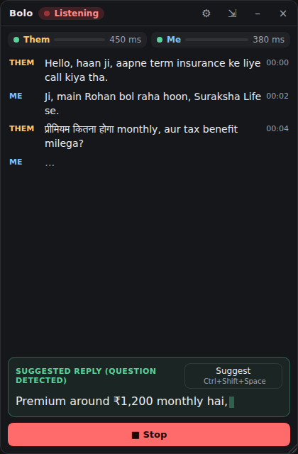
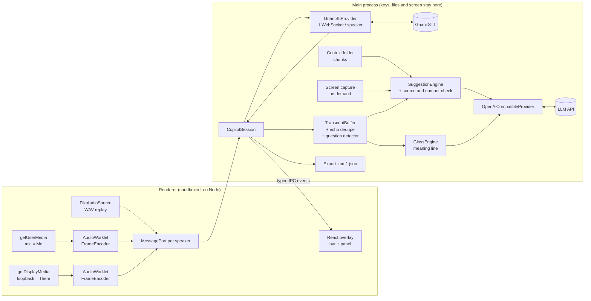

# Bolo — the meeting buddy that knows your work

A client asks "how much stock do you have of the blue 5 litre, and what's the bulk rate?"
A couple of seconds later the exact figure from **your own files** is on your screen, with
the file it came from, in a glass bar that **does not appear in your screen share**. When
the meeting ends, the **minutes** are already written: summary, decisions, action items.

Bolo is a small Windows desktop app that sits on top of your Zoom, Meet or Teams call. It
transcribes **both sides** of the conversation live with **Gnani's speech-to-text**, which
handles Hindi, Tamil and other Indian languages and code-mixed speech like Hinglish.

**During the meeting**, in the mode you pick (**Silent**: transcribe only · **Assist**:
answers when you ask · **Active**: also answers their questions on its own), with a
**pause** button for anything off the record:

- **Answers from your files and your past meetings.** Point it at a folder with your stock
  sheet, price list or project notes; the minutes of every earlier meeting count too. When
  they ask a question, Bolo answers from those and names the file or meeting. If the fact
  is not there, it says so; it does not make up a number.
- **Catches you up.** Drifted off? One hotkey gives you the last 10 minutes in a few
  bullets, starting with anything they asked you.
- **Alerts you when they say your name** or a word you watch for (a project, a client),
  even in Silent mode. A question for you brings the hidden overlay back.
- **Stays out of the screen share.** The overlay is excluded from screen capture, so the
  people you are sharing with do not see it.
- **Explains mixed-language lines.** Under a line that mixes in words you may not know,
  it shows the plain meaning in the language you read.
- **Reads your screen when you ask.** One hotkey sends a picture of your screen with your
  question. Never in the background.

**After the meeting**, everything stays on your computer:

- **Minutes of the meeting (MOM).** Summary, key points, decisions, action items with
  owners, open questions and next steps, written from the transcript and your notes. Any
  figure nobody said in the meeting is flagged for you to check.
- **A meeting library.** Every meeting with its transcript, Bolo's answers, your notes and
  the minutes, searchable across all meetings. Edit the minutes, then copy them for email
  or chat, open them in your mail app, or save them as PDF or Markdown.
- **Ask your meetings.** "What rate did we agree with Mehta?" is answered from all your
  saved meetings, with a link to the one it came from.
- **Who said what.** Name the other side, or let Bolo suggest a name for each line from
  the conversation ("Thanks, Rohan"). It only uses names that were invited or actually
  said, and marks its guesses until you confirm them.

**Your calendar**, read-only from its private iCal link or an `.ics` file: Bolo offers
"Mehta follow-up · starts in 3 min · Start with Bolo", and a meeting started that way
takes the invite's title, people and agenda into its answers and minutes.

Built for sales reps, small business owners, brokers, agents and anyone who takes meetings
in Indian languages. Built for Gnani AI's Great Indian AI Internship Challenge.

<p align="center"></p>

<sub>Screenshot from the automated end-to-end test on Windows, with synthetic data.</sub>

## Contents

- [Status](#status)
- [Quick start (Windows)](#quick-start-windows)
- [Try it with no keys](#try-it-with-no-keys)
- [Try it free, without a Gnani key](#try-it-free-without-a-gnani-key)
- [Environment variables](#environment-variables)
- [Using Bolo](#using-bolo)
- [Connect your calendar](#connect-your-calendar)
- [How answers are kept honest](#how-answers-are-kept-honest)
- [Architecture](#architecture)
- [Gnani integration and what to verify](#gnani-integration-and-what-to-verify)
- [Suggestion models](#suggestion-models)
- [Security and privacy](#security-and-privacy)
- [Testing](#testing)
- [Windows installer](#windows-installer)
- [Dependencies](#dependencies)
- [Project layout](#project-layout)

## Status

Checked on Windows 11 (build 26100) on 2026-10-09.

| Area                                                              | State                                                                                                                                          |
| ----------------------------------------------------------------- | ---------------------------------------------------------------------------------------------------------------------------------------------- |
| Audio pipeline, transcript, echo removal, question detection      | Done, unit-tested                                                                                                                              |
| Context files: loading, chunking, selection                       | Done, unit-tested                                                                                                                              |
| Answers: source parsing, number check, labels, trigger precedence | Done, unit-tested                                                                                                                              |
| Meaning line for mixed-language speech                            | Done, unit-tested                                                                                                                              |
| Modes (Silent / Assist / Active) and pause                        | Done, unit-tested                                                                                                                              |
| Past meetings in answers, ask your meetings, catch-up, alerts     | Done, unit-tested and end to end with the mock model (2026-10-26)                                                                              |
| Calendar (iCal link or file), speaker names, guessing speakers    | Done, unit-tested and end to end with an .ics file and the mock model (2026-10-28). Not yet tried with a real Google/Outlook link              |
| Minutes, meeting library, search, PDF/Markdown/email export       | Done, unit-tested; minutes not yet written by a real model, only the mock (2026-10-26)                                                         |
| The whole app end to end (Electron, real windows)                 | **Passes on Windows** (2026-10-28) against the mock Gnani and mock AI servers: 49 checks, `npm run test:e2e`                                   |
| Live microphone + system-audio loopback                           | **Works on Windows**: both streams deliver audio to the mock Gnani server, `npm run test:live`                                                 |
| Hidden from screen capture                                        | **Verified on Windows** with a screen capture, transparent and opaque window. Not yet checked inside a real Zoom/Meet/Teams share              |
| Screen reading                                                    | Capture and request path tested end to end with a mock model. Not yet run with a real vision model                                             |
| Gnani realtime STT client                                         | **Run against the real API** (2026-10-23), alone and in the full app with real answers — see [what was checked](#checked-against-the-real-api) |
| Windows installer (NSIS)                                          | Config done; build the `.exe` with `npm run dist:win`                                                                                          |

Manual test plan: [docs/WINDOWS_TESTING.md](docs/WINDOWS_TESTING.md). Design record:
[docs/designs/bolo-context-copilot.md](docs/designs/bolo-context-copilot.md).

## Quick start (Windows)

Requires Node.js 22 LTS or newer.

```powershell
git clone <this repo>; cd gnani
npm ci
copy .env.example .env      # then fill in GNANI_API_KEY and the LLM_* values
npm run dev
```

If the app does not start and says Electron failed to install, your npm is set to skip
install scripts. Run `node node_modules/electron/install.js` once.

Bolo appears as a slim bar at the top-centre of the screen. On first launch it shows a
consent notice. Then:

1. Open **Context**, choose the folder with your files.
2. Open **Settings → Audio**, pick **Live** (mic + system audio) or **Replay WAV files**.
3. Press **Start**.

| Script                                | What it does                                                                         |
| ------------------------------------- | ------------------------------------------------------------------------------------ |
| `npm run dev`                         | Run the app with hot reload                                                          |
| `npm run build`                       | Build main, preload and renderer into `out/`                                         |
| `npm run lint` / `typecheck` / `test` | ESLint, TypeScript (node, preload, web), Vitest                                      |
| `npm run mock-gnani`                  | Local mock of Gnani's STT WebSocket, for offline runs                                |
| `npm run mock-llm`                    | Local scripted stand-in for the AI model, for offline runs                           |
| `npm run demo-audio`                  | Synthesise the fictional Hinglish demo call with Gnani TTS                           |
| `npm run fixtures`                    | Regenerate the synthetic test WAVs                                                   |
| `npm run dist:win`                    | Build the Windows installer (run on Windows)                                         |
| `npm run test:e2e` / `test:live`      | Optional end-to-end tests of the real app (need Playwright, see [Testing](#testing)) |

## Try it with no keys

Everything below runs on your machine. No Gnani credits, no AI model.

```powershell
npm run mock-gnani                                   # terminal 1
npm run mock-llm                                     # terminal 2
$env:GNANI_API_KEY="test-key"                        # terminal 3
$env:GNANI_STT_URL="ws://127.0.0.1:8787/stt/v3/stream"
$env:LLM_BASE_URL="http://127.0.0.1:8788/v1"; $env:LLM_MODEL="mock"
npm run dev
```

1. **Context → Choose folder…** → pick `demo-context` in this repo (a made-up paint
   distributor: stock, prices, call notes).
2. **Settings → Audio → Replay WAV files** → choose `test\fixtures\them.wav` and
   `test\fixtures\me.wav`.
3. **Start**. The fixtures are tone bursts, not voices; the mock "transcribes" each tone
   into a scripted Hinglish line. You will see the dealer's question, its meaning in
   English, and **Answer · from your files** with `inventory.csv` and `price-list.md`.
4. While it runs, type `what did we promise on delivery?` in the bar and press Enter.
   Then try `what is their GST number?` to see the "not in your files" card.

**With real speech and the real Gnani API:** `npm run demo-audio` creates
`demo-audio\them.wav` and `demo-audio\me.wav`, the same kind of call spoken by Gnani's
own TTS voices, with three questions the demo files answer. In Bolo, **Settings → Audio →
Demo** loads them. Use 1× speed against the real API: Gnani wants real-time cadence.

**Recording a demo video:** a protected overlay does not show up in a screen recording.
Set `BOLO_RECORDABLE=1` to turn protection off while you record. The bar then says so in
amber. To show the hiding itself, record a second clip of a real screen share with
protection on.

## Try it free, without a Gnani key

For testing before you have Gnani credits, Bolo can use any OpenAI-compatible
`/audio/transcriptions` endpoint instead. **Groq's free tier** covers both halves with one
key and no card: Whisper for speech-to-text, and a chat model for answers. Create a key at
console.groq.com, then put this in `.env`:

```
STT_PROVIDER=whisper
LLM_BASE_URL=https://api.groq.com/openai/v1
LLM_MODEL=openai/gpt-oss-20b
LLM_API_KEY=gsk_your_key
LLM_REASONING_EFFORT=low
```

The Whisper adapter defaults to Groq's endpoint and reuses `LLM_API_KEY` because it is the
same service. Then set **Settings → AI model → File content sent per answer** to 8k or
less: Groq's free chat limit is about 8,000 tokens a minute.

What changes compared with Gnani:

- **Lines appear after each pause, not while you speak.** Whisper takes whole clips, so Bolo
  cuts the audio at pauses (0.7 s) and sends each piece. Expect roughly a second more delay.
- **Limits.** Groq's free tier (checked October 2026, shared by all keys in one account):
  Whisper 20 requests a minute and about 8 hours of audio a day, chat about 1,000
  requests and 200,000 tokens a day. A rate limit shows on the dot as a short retry.
- **Hinglish comes back mostly in Devanagari**, English words included.
- **No screen reading on the free Groq models**: none of them accepts images.
- **Free tiers are for synthetic or consented calls.** Read the provider's data terms before
  using real customer conversations.

A local Whisper server works too: set `WHISPER_BASE_URL` to its `/v1` URL and leave the
key empty. For the submission and demo video, switch back to Gnani by removing
`STT_PROVIDER`.

## Environment variables

Keys are read **only by the Electron main process**, never sent to the UI and never
logged. Bolo looks for them in this order: real environment variables, then `.env` in the
folder you start Bolo from (development), then `%APPDATA%\Bolo\.env` (installed app).

| Variable               | Required    | Meaning                                                                                                                              |
| ---------------------- | ----------- | ------------------------------------------------------------------------------------------------------------------------------------ |
| `GNANI_API_KEY`        | yes\*       | Gnani API key, sent as the `x-api-key-id` header                                                                                     |
| `GNANI_STT_URL`        | no          | Streaming endpoint. Default `wss://api.vachana.ai/stt/v3/stream`. Point it at the mock with `ws://127.0.0.1:8787/stt/v3/stream`      |
| `LLM_BASE_URL`         | for answers | Any OpenAI-compatible API, e.g. `https://api.openai.com/v1`, `http://localhost:11434/v1` (Ollama), `http://<host>:8000/v1` (vLLM)    |
| `LLM_MODEL`            | for answers | e.g. `gpt-4o-mini`, `llama3.2`                                                                                                       |
| `LLM_API_KEY`          | depends     | Bearer token; leave empty for local servers                                                                                          |
| `LLM_REASONING_EFFORT` | no          | For thinking models: `low` (or `none` on Gemini 2.5 Flash) makes them answer in seconds instead of 20 s or more. Not sent when empty |
| `BOLO_OPAQUE_WINDOW`   | no          | `1` = opaque overlay, for GPUs that render transparent windows badly                                                                 |
| `BOLO_RECORDABLE`      | no          | `1` = demo mode: the overlay is visible in screen recordings and shares                                                              |
| `BOLO_USER_DATA`       | no          | Settings folder to use instead of `%APPDATA%\Bolo` (the end-to-end tests use a throwaway one)                                        |
| `GNANI_TTS_URL`        | no          | Override the TTS endpoint used by `npm run demo-audio`                                                                               |
| `STT_PROVIDER`         | no          | `whisper` = use a Whisper endpoint instead of Gnani, for testing (see above). Default `gnani`                                        |
| `WHISPER_BASE_URL`     | no          | Default `https://api.groq.com/openai/v1`. Any OpenAI-compatible `/audio/transcriptions` server                                       |
| `WHISPER_MODEL`        | no          | Default `whisper-large-v3`. `whisper-large-v3-turbo` is faster and a little less accurate                                            |
| `WHISPER_API_KEY`      | no          | Defaults to `LLM_API_KEY` when both point at the same service; never sent to a different one                                         |

\* Not needed with `STT_PROVIDER=whisper`.

The LLM base URL, model and vision model can also be changed in Settings; those values
override the `.env` defaults. Keys can only come from the environment. A base URL typed
into Settings must be `https`, or plain `http` to this computer or the local network: the
key, the transcript and your files travel in that request.

## Using Bolo

| Hotkey             | Action                                          |
| ------------------ | ----------------------------------------------- |
| `Ctrl+Shift+Space` | Answer what they just said, from any app        |
| `Ctrl+Alt+Space`   | Answer from my screen (needs a vision model)    |
| `Ctrl+Shift+U`     | Catch me up: the last 10 minutes in bullets     |
| `Ctrl+Shift+H`     | Show / hide the overlay (doesn't steal focus)   |
| `Ctrl+Shift+M`     | Click-through: mouse goes to the app underneath |

**The bar.** Start/Stop with a call timer; pause; one dot per side (green = connected, hover
for latency); the mode chip; the Ask box; a screen toggle; a shield; expand/collapse; a
menu. The window is exactly as tall as what is open, and the bar is the drag handle.

**Modes.** Click the chip on the bar to switch, even mid-meeting:

| Mode   | During the meeting                                                 |
| ------ | ------------------------------------------------------------------ |
| Silent | Transcribes only. No AI request unless you ask (hotkey or Ask box) |
| Assist | Answers when you ask; plain meaning under mixed-language lines     |
| Active | Also answers their questions on its own (the default)              |

**Pause** (⏸ next to the timer) stops sending audio to speech-to-text until you resume.
Nothing said meanwhile is heard or saved; the transcript marks the gap.

**After the meeting.** Stop saves the meeting to the library on this computer
(`%APPDATA%\Bolo\meetings`) and, with an AI model set, writes the minutes in the
background. Click the "Meeting saved" notice, or **⋯ → Meetings**, to open the library.
Set **Context → My name** so the minutes say who you are. Add notes in **Notes & answers**
and press **Rewrite** to include them. Turn automatic minutes off under **Settings → After
the meeting**; the old export to a folder (.md + .json transcript) is there too.

**Past meetings in answers.** The minutes and notes of your 40 newest meetings are used
like files in the context folder: the parts that match a question go to your AI model, and
an answer that uses them says **Answer · from past meetings** with the meeting as its
source. Turn it off in **Context**. In the library, type a question in the search box and
press Enter to **ask your meetings**; transcripts are searched too.

**Alerts.** Set **Context → My name** and **Alert me on** (comma-separated). When they say
one, a strip shows the line; if it was a question, an **Answer** button, and a hidden
overlay comes back. Speech-to-text may write names in another script (Hindi writes Krunal
as क्रुणाल), so add that spelling as a watch word. Matching is plain text, no AI.

**Calendar.** In **Context → Calendar**, paste your calendar's private iCal link
(Google Calendar: Settings → your calendar → _Secret address in iCal format_; Outlook:
Settings → Calendar → Shared calendars → _Publish a calendar_ → ICS) or choose an `.ics`
file. Bolo reads it every 10 minutes, never writes to it, and lists today's and
tomorrow's meetings. Ten minutes before one starts, a strip offers **Start with Bolo**
(and **Join** for a Meet, Zoom or Teams link). A call started that way is saved under the
invite's title; the invited people and the invite's description (as the agenda) go into
answers and minutes; and a 1:1 invite names "Them" for you. Recurring meetings, time
zones (Outlook's Windows zone names included), moved and cancelled occurrences are
handled; "second Tuesday of the month" style rules show only their first date.

**Who said what.** Speech-to-text hears two channels: your microphone ("Me") and
everyone else ("Them"). In the library's **Transcript** tab, name the other side (**They
are**), pick a name for any line, or press **Guess who said what**: the AI names lines
from cues in the conversation, keeps only names that were invited or said aloud, and
marks each guess (_Mehta ?_) until you pick it. Names you set are never overwritten.
Minutes, search and "ask your meetings" use the names; press **Rewrite** in Minutes to
apply new ones.

**The shield** is green and reads "Hidden from screen share" only on a Windows build
where that was checked. Anywhere else it is amber: "May be visible when sharing".

**Context folder.** `.txt`, `.md`, `.csv`, `.tsv` and `.json` files at the top level of
one folder. Limits: 50 files, 1 MB each, 4 MB in total. Other files are listed as skipped
with the reason. Excel users: save as **CSV UTF-8**. Files are read when a call starts
and when you press Reload.

**Answers** appear by themselves when they ask a question, on the hotkey, or when you
type a question in the bar. Everything answers only while a call (live or replay) is
running.

| Card title                 | What it means                                                                          |
| -------------------------- | -------------------------------------------------------------------------------------- |
| Answer · checking          | Still arriving. Nothing is claimed yet                                                 |
| Answer · from your files   | A file that was sent is cited, and every number in the answer appears in what was sent |
| Answer · from this call    | Taken from the transcript or your note, numbers checked the same way                   |
| Answer · from your screen  | Read off a screenshot by the AI model. Bolo cannot check it, and says so               |
| Answer · not in your files | The fact was not found. You get a polite line to buy time                              |
| Answer · check this figure | A number in the answer is not in your files or the call. Do not read it out            |
| Suggested reply            | A plain reply that needs no fact, or no context folder is loaded                       |

**Meaning line.** Set the language you read in Settings. Under a line from the other
person that mixes in other languages, Bolo shows the plain meaning. Click any of their
lines to explain it again. Turn it off with "Show a plain meaning…".

**Screen.** Set a **Vision model** in Settings (a model that accepts images). Then
`Ctrl+Alt+Space` answers from your screen, or switch on the screen toggle in the Ask box
to attach the screen to one typed question. One still picture is taken at that moment,
sent to that model, and kept nowhere.

**Also:** reply language (same as the call, Hinglish in Roman script, or English); echo
removal when you are not on headphones; a silence gate to save credits; and an export of
the transcript, meanings, answers and their sources as Markdown and JSON when a call ends.

## Connect your calendar

Bolo reads your meetings three ways. Use any one; they can be combined.

| Way | Setup | What you get |
| --- | --- | --- |
| **Sign in with Google** | A Google Cloud OAuth client (below), once | Live calendar, people, Meet links, agenda |
| **Sign in with Outlook / Microsoft 365** | An Azure app registration (below), once | Live calendar, people, Teams links, agenda |
| **iCal link or .ics file** | Nothing: paste the calendar's private iCal address | Read-only copy, refreshed every 10 minutes |

Sign-in opens your browser; Bolo never sees your password. It asks for **read-only**
calendar access, keeps the refresh token encrypted on this computer (Windows DPAPI), and
**Disconnect** removes it (and revokes Google's grant).

### Google (about 5 minutes)

1. [Google Cloud Console](https://console.cloud.google.com/) → create a project.
2. **APIs & Services → Library** → enable **Google Calendar API**.
3. **OAuth consent screen** → External → app name "Bolo", your email → add scope
   `.../auth/calendar.events.readonly` → add yourself (and demo users) as **Test users**.
4. **Credentials → Create credentials → OAuth client ID → Desktop app**.
5. Put the client ID and secret in `.env`: `GOOGLE_CLIENT_ID=…` and
   `GOOGLE_CLIENT_SECRET=…` (a Desktop client's secret is not confidential; PKCE
   protects the sign-in). Restart Bolo.

While the app is in "Testing", only the test users you added can sign in, and Google asks
them to sign in again every 7 days. That is fine for a demo; publishing removes both.

### Outlook / Microsoft 365 (about 5 minutes)

1. [Azure portal](https://portal.azure.com/) → **App registrations → New registration**:
   name "Bolo", supported accounts "Any organizational directory and personal Microsoft
   accounts".
2. **Authentication → Add a platform → Mobile and desktop applications** → custom redirect
   URI `http://localhost` → Save. Set **Allow public client flows** to Yes.
3. **API permissions → Add → Microsoft Graph → Delegated** → `Calendars.Read`,
   `User.Read`, `offline_access`.
4. Copy the **Application (client) ID** into `.env` as `MICROSOFT_CLIENT_ID=…`. Restart.

Work accounts may need an admin to approve the app the first time.

### Calls in other apps

With **Settings → Notice calls in Zoom, Teams, Meet and others** on (the default), Bolo
offers to start when another app starts using your microphone, which is how Windows
itself knows to show the mic icon. It reads only which app is using the mic; no audio,
no window titles. When that app lets go of the mic while Bolo is still listening, Bolo
reminds you to stop and save.

## How answers are kept honest

A model can invent a figure and still say it came from your file. So Bolo checks:

1. The model must end its reply with a source line, for example
   `[source: inventory.csv, transcript]`. Bolo removes that line from what you see.
2. A cited file counts only if its content was actually in that request.
3. Every number in the answer must appear, as a whole number, in the file content that
   was sent, your note, the transcript or your typed question. `50` does not pass because
   the file says `1500`. Commas, currency signs, `12.50` versus `12.5` and Indian-script
   digits are handled.
4. Only then does the card say "from your files". A failed check says "check this figure".

Known limits: a total the model worked out itself fails the check, and so does a number
your files only spell out in words. That is on purpose: a false warning is cheap, a wrong
figure read to a client is not. On a folder larger than the context budget, files are
searched by matching words, so a Hindi word will not find its English column name; small
folders are sent whole.

## Architecture



**Two streams instead of diarization.** Mic = "me", system audio = "them". Each is its own
WebSocket to Gnani, so every line is labelled correctly without a speaker model.

**Every external piece is behind an interface**, so each can be swapped or mocked:

| Interface                                                   | Implementation              | Mock used in tests                                                       |
| ----------------------------------------------------------- | --------------------------- | ------------------------------------------------------------------------ |
| `SttProvider` (`src/core/stt/types.ts`)                     | `GnaniSttProvider`          | `test/mock/mock-gnani-server.ts` (real WebSocket server with energy VAD) |
| `LlmProvider` (`src/core/llm/types.ts`)                     | `OpenAiCompatibleProvider`  | `test/mock/mock-llm-server.ts` (real HTTP SSE server)                    |
| `AudioSourceController` (`src/renderer/src/audio/types.ts`) | `LiveCapture`, `FileReplay` | WAV fixtures through `FileAudioSource`                                   |

**Audio path.** 48 kHz (or any rate) Float32 → downmix → streaming windowed-sinc resampler
→ 16 kHz → PCM16 little-endian → exact 1024-byte frames (512 samples = 32 ms).
`FrameEncoder` does all of this; the AudioWorklet and the file replay both use it, so the
two paths produce identical frames.

**Session logic** (`src/core/session/copilot-session.ts`) knows nothing about Electron, so
the whole flow is tested in Node with the WAV fixtures and both mock servers.

**Pure, tested building blocks:**

- `core/context/context.ts` — decoding (UTF-8, UTF-16 with a byte-order mark; anything
  else is skipped, never garbled), CSV rows with quoted line breaks, chunking, and
  selection: everything if it fits the budget, otherwise the chunks sharing the rarest
  words with the question.
- `core/suggest/answer.ts` — source-line parsing, the number check, and the one ordered
  rule that picks the card label.
- `core/suggest/engine.ts` — one answer at a time. Your own request cancels the one in
  flight. A question from the caller that arrives while an answer is busy is kept (newest
  only) and answered next, so two quick questions both get answers.
- `core/gloss/engine.ts` — the meaning line: one request at a time, in order; a slow,
  failed or stale request leaves its line without a meaning and never holds up the
  transcript or an answer.
- `question-detector.ts`, `echo-dedupe.ts`, `transcript/buffer.ts`, `resampler.ts`,
  `pcm16.ts`, `chunker.ts`, `wav.ts`, `silence-gate.ts`.

**The window.** A frameless, transparent, always-on-top window 620 px wide at the
top-centre. The renderer reports the height of its content and the main process resizes
the window to match, so nothing invisible blocks clicks on the app underneath.

## Gnani integration and what to verify

`docs.gnani.ai` was blocked from the environment this was first built in, so the protocol
was taken from the **official `gnani-vachana` Python SDK (v0.7.9, PyPI)** source. All of it
lives in one adapter file: [`src/core/stt/gnani-protocol.ts`](src/core/stt/gnani-protocol.ts).

What the SDK establishes:

- Endpoint `wss://api.vachana.ai/stt/v3/stream`.
- Auth and configuration via **upgrade headers only**: `x-api-key-id`, `lang_code`
  (e.g. `hi-IN`), `x-sample-rate: 16000`, `x-api-request-id` (`req_` + 12 hex). Optional
  `x-format: transcribe` writes numbers as digits (Hindi/English only).
- Server messages: `connected` (with `config.sample_rate`/`chunk_size`), `processing`,
  `transcript` (`text`, `audio_duration_ms`, `segment_id`, `segment_index`, `latency`,
  `timestamp`), `error`, and VAD events (`speech_start`/`speech_end`/…).
- Client sends raw PCM16 LE mono frames of exactly 1024 bytes at real-time cadence
  (32 ms at 16 kHz). Don't buffer and burst; it hurts the VAD.
- Streaming languages: hi-IN, en-IN, ta-IN, te-IN, kn-IN, ml-IN, mr-IN, bn-IN, gu-IN, pa-IN.

### Checked against the real API

Run with a real key on 2026-10-23. What is still open is marked `TODO(verify-gnani)` in
the code.

1. **Endpoint**: `wss://api.vachana.ai/stt/v3/stream` works.
2. **Handshake**: headers only. The first message is `connected`, with a config that
   includes `chunk_size: 512` and `partials_enabled: false`.
3. **Bad key**: HTTP 401 on the upgrade (`INVALID_API_KEY`). Bolo shows a red error and
   does not retry.
4. **Messages**: `speech_start`, then one final `transcript` per utterance. No partial
   results and no `processing` message.
5. **Fields**: `segment_index` is a number. `latency` is a number (144–269 ms seen), but
   what it measures is still unconfirmed.
6. **Hinglish**: `en-hi-in-cm` is refused, so Bolo no longer offers it. `hi-IN` handles
   Hinglish and writes English words in Devanagari ("एक्सटीरियर इमल्शन 5 लीटर").
7. **Auto-detect**: comma-separated lists are refused. Bolo sends `indic-auto`, which is
   accepted; its accuracy is untested. A refused language (close code 1008) is a red
   error, not endless retries.
8. **End of stream**: closing the socket loses an unfinished sentence, and there is no
   flush message. On Stop, Bolo sends up to 3 s of silence until the last line comes back.
9. **Idle**: the server ends a stream after 60 s without speech, even with pings. Bolo
   reconnects.
10. **TTS for `npm run demo-audio`**: works as written (`timbre-v2.5`, voices `Poorvi` and
    `Roopesh`, `language: "auto"`).

## Suggestion models

`OpenAiCompatibleProvider` streams from any `/chat/completions` endpoint, so a single
implementation covers:

| Setup                        | `LLM_BASE_URL`              | `LLM_MODEL`                 | `LLM_API_KEY` |
| ---------------------------- | --------------------------- | --------------------------- | ------------- |
| OpenAI                       | `https://api.openai.com/v1` | `gpt-4o-mini`               | your key      |
| Groq / Together / OpenRouter | their `/v1` URL             | their model id              | your key      |
| Ollama on your laptop        | `http://localhost:11434/v1` | `llama3.2`, `qwen2.5:7b`, … | (empty)       |
| Any model on vLLM            | `http://<host>:8000/v1`     | the served model name       | if configured |

A hosted model gives the fastest first words. Local models work, with two things to know:
lower **File content sent per answer** in Settings so the prompt fits the model's context
window, and consider turning the meaning line off, because it adds one request per line
they say. `<think>` blocks from reasoning models are stripped. Screen reading uses the
**Vision model** from Settings, on the same base URL and key.

## Security and privacy

- `contextIsolation: true`, `nodeIntegration: false`, `sandbox: true`. The renderer only
  sees the typed API in [`src/preload/api.ts`](src/preload/api.ts).
- API keys stay in the main process. The UI only learns whether a key was found. Keys are
  never logged, and error messages never echo them (tested).
- **Your files stay in the main process.** The UI gets file names and sizes only (tested).
  File content goes to the AI model you configured, to answer questions, and nowhere else.
- **Screenshots are taken only when you ask**, in the main process, with the overlay
  hidden for the capture. The image is sent to the vision model for that one request,
  never written to disk, never sent to the UI and never exported (tested).
- File content, the transcript and anything on your screen are passed to the model as
  reference data with the instruction never to follow instructions found inside them.
- IPC handlers accept messages only from the overlay's top frame. Settings from the
  renderer are validated field by field, and the export and context folders can only be
  set through the native folder dialog (tested).
- Strict Content-Security-Policy; navigation and new windows are blocked; only the
  `media` and `display-capture` permissions are granted.
- First-run notice says what is sent where, and reminds you to get the other party's
  consent before recording.
- **The calendar is read, never written.** The iCal link is fetched over https only; the
  windows get titles, times and names, and an invite's description stays in the main
  process until a call is started from it. A **Join** button opens only the Meet, Zoom or
  Teams https link found in the invite.
- **Meetings are saved on this computer** (`%APPDATA%\Bolo\meetings`), one JSON file
  each, until you delete them in the library. A copy goes to an export folder only if
  you set one.
- Fixtures, demo audio and demo files are synthetic. No real personal data is used
  anywhere.

## Testing

```powershell
npm test        # 222 tests: audio, STT client vs mock server, LLM vs mock server, context
                # files, answer checks, meanings, session end to end with WAV fixtures,
                # export, settings, UI reducer
```

Two optional checks drive the **real app**. They need Playwright, which is not a
dependency, so install it temporarily:

```powershell
npm run build
npm i --no-save playwright
npm run test:e2e    # the Electron app vs mock Gnani + mock AI, replaying fixtures: bar
                    # position and size, context folder, grounded answer, typed question,
                    # "not in your files", screen answer, meanings, export, key handling
npm run test:live   # real microphone + system-audio loopback into the mock Gnani server
```

Both pass on Windows 11. Screenshots go to `test-results/`. If you start them from a
terminal inside an Electron-based editor and the app exits at once, clear
`ELECTRON_RUN_AS_NODE` first (the scripts already do this for the app they launch).

## Windows installer

```powershell
npm run dist:win    # → release\Bolo-Setup-0.1.0.exe
```

A per-user NSIS installer (no admin), with Start menu and desktop shortcuts and a
choosable folder. It's unsigned, so SmartScreen will warn. Settings and
`%APPDATA%\Bolo\.env` are kept on uninstall. Config:
[`electron-builder.yml`](electron-builder.yml).

## Dependencies

Runtime: **`ws`** only — the WebSocket client for Gnani. Gnani authenticates with custom
headers on the WebSocket upgrade request, which the standard WebSocket API can't set.

Development:

| Package                                                                             | Why                                                                                       |
| ----------------------------------------------------------------------------------- | ----------------------------------------------------------------------------------------- |
| `electron`, `electron-vite`, `vite`, `@vitejs/plugin-react`                         | App runtime and build (main, preload, renderer; bundles the AudioWorklet as its own file) |
| `react`, `react-dom`                                                                | Overlay UI (bundled into the renderer, so dev-only)                                       |
| `typescript`, `@types/*`                                                            | Types. TypeScript is pinned to 6.0 because `typescript-eslint` doesn't support 7 yet      |
| `vitest`                                                                            | Tests                                                                                     |
| `eslint`, `@eslint/js`, `typescript-eslint`, `eslint-plugin-react-hooks`, `globals` | Linting                                                                                   |
| `prettier`                                                                          | Formatting                                                                                |
| `electron-builder`                                                                  | Windows installer                                                                         |

Deliberately avoided: `dotenv`, an OpenAI SDK (`fetch` + a small SSE parser), any audio
or resampling library, an OCR library (the screenshot goes to a vision model), and a
vector database (word matching, with whole-folder sending for small folders). Scripts in
`scripts/*.ts` run directly with Node ≥ 22.18's built-in TypeScript type-stripping.

## Project layout

```
src/
  shared/            pure code used by main and renderer (and tests)
    audio/           resampler, pcm16, chunker, frame-encoder, wav, silence-gate, file-audio-source
    transcript/      types, TranscriptBuffer, prompt formatter
    suggest/         question detector, echo dedupe
    settings.ts      settings schema + validation
    ipc.ts           IPC channel names and event types
    meeting.ts       meeting library types
    speakers.ts      speaker names for "them" lines, participants
    calendar.ts      calendar view types, "starting soon"
    markdown.ts      escaping Markdown renderer for the minutes
  core/              Node-only logic, no Electron imports (testable)
    stt/             SttProvider, Gnani protocol adapter + provider, backoff
    llm/             LlmProvider, OpenAI-compatible provider, SSE parser, think filter
    context/         reference files: decode, chunk, select
    suggest/         prompt builder, answer checks, SuggestionEngine
    gloss/           meaning line for mixed-language speech
    session/         CopilotSession (modes, pause, catch-up, calendar meeting), alerts, export
    calendar/        iCalendar parser: time zones, recurrence, exceptions
    minutes/         minutes of the meeting: prompts, long-meeting map/reduce, figure check, PDF page
    meetings/        meeting library: file store, search, MeetingService, past meetings
                     as answer context, "ask your meetings", guessing speakers
  main/              Electron main: overlay + library windows, hotkeys, IPC, permissions,
                     settings store, context folder loader, screen capture, PDF export,
                     calendar reader
  preload/           contextBridge API
  renderer/          React overlay (bar, tabs, answer card), meeting library (#library),
                     AudioWorklet, live capture, file replay
test/                Vitest tests, mock servers, synthetic fixtures
scripts/             fixtures, mock servers, demo audio, end-to-end checks
demo-context/        synthetic stock sheet, price list and call notes for the demo
docs/                WINDOWS_TESTING.md, design record
build/               app icon
```
