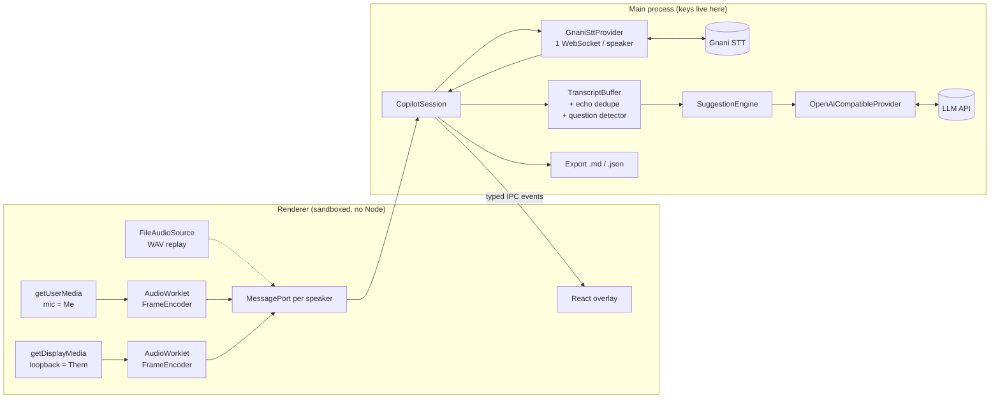

# Bolo — real-time AI copilot for Indian-language calls

Bolo is a small Windows desktop app that sits on top of your Zoom, Meet or Teams call.
It transcribes **both sides** of the conversation live with **Gnani's speech-to-text**,
which handles Hindi, Tamil and other Indian languages and code-mixed speech like
Hinglish. It shows short reply suggestions you can say out loud, in a discreet overlay
that is hidden from screen sharing.

Built for sales reps, small business owners, brokers and agents who take calls in Indian
languages. Built for Gnani AI's Great Indian AI Internship Challenge.

<p align="center"></p>

<sub>Screenshot from the automated UI test, with synthetic conversation data.</sub>

## Contents

- [Status](#status)
- [Quick start (Windows)](#quick-start-windows)
- [Environment variables](#environment-variables)
- [File-replay mode](#file-replay-mode-no-microphone-needed)
- [Using Bolo](#using-bolo)
- [Architecture](#architecture)
- [Gnani integration and what to verify](#gnani-integration-and-what-to-verify)
- [Suggestion models](#suggestion-models)
- [Security and privacy](#security-and-privacy)
- [Testing](#testing)
- [Windows installer](#windows-installer)
- [Dependencies](#dependencies)
- [Project layout](#project-layout)

## Status

| Area                                                                           | State                                                                                                                                  |
| ------------------------------------------------------------------------------ | -------------------------------------------------------------------------------------------------------------------------------------- |
| Audio pipeline (resample → PCM16 → 1024-byte frames, silence gate, WAV replay) | Done, unit-tested                                                                                                                      |
| Gnani realtime STT client (reconnect, heartbeat, latency)                      | Done, tested against a mock server. **Not yet run against the real API** — see [what to verify](#gnani-integration-and-what-to-verify) |
| Transcript buffer, echo dedupe, question detector                              | Done, unit-tested                                                                                                                      |
| LLM client (OpenAI-compatible, streaming), prompt, suggestion engine           | Done, tested against a mock server                                                                                                     |
| Electron overlay, IPC, hotkeys, settings, export                               | Done. Real Electron end-to-end test passes on Linux/Xvfb with mock servers                                                             |
| Live mic + system-audio loopback (Windows)                                     | Written. Mic → AudioWorklet path checked in Chromium with a fake mic; **loopback untested on Windows**                                 |
| Windows installer (NSIS)                                                       | Config done; `--win --dir` packaging checked. Build the `.exe` on Windows                                                              |

Manual test plan for your laptop: [docs/WINDOWS_TESTING.md](docs/WINDOWS_TESTING.md).

## Quick start (Windows)

Requires Node.js 22 LTS or newer.

```powershell
git clone <this repo>; cd gnani
npm ci
copy .env.example .env      # then fill in GNANI_API_KEY and the LLM_* values
npm run dev
```

On first launch Bolo shows a consent notice. Then pick **Live** (mic + system audio) or
**Replay WAV files** in Settings and press **▶ Start**.

| Script                                | What it does                                                                            |
| ------------------------------------- | --------------------------------------------------------------------------------------- |
| `npm run dev`                         | Run the app with hot reload                                                             |
| `npm run build`                       | Build main, preload and renderer into `out/`                                            |
| `npm run lint` / `typecheck` / `test` | ESLint, TypeScript (node, preload, web), Vitest                                         |
| `npm run mock-gnani`                  | Local mock of Gnani's STT WebSocket, for offline runs                                   |
| `npm run demo-audio`                  | Synthesise a fictional Hinglish demo call with Gnani TTS                                |
| `npm run fixtures`                    | Regenerate the synthetic test WAVs                                                      |
| `npm run dist:win`                    | Build the Windows installer (run on Windows)                                            |
| `npm run test:ui` / `test:e2e`        | Optional browser / Electron end-to-end tests (need Playwright, see [Testing](#testing)) |

## Environment variables

Keys are read **only by the Electron main process**, never sent to the UI and never
logged. Bolo looks for them in this order: real environment variables, then `.env` in the
folder you start Bolo from (development), then `%APPDATA%\Bolo\.env` (installed app).

| Variable             | Required        | Meaning                                                                                                                           |
| -------------------- | --------------- | --------------------------------------------------------------------------------------------------------------------------------- |
| `GNANI_API_KEY`      | yes             | Gnani API key, sent as the `x-api-key-id` header                                                                                  |
| `GNANI_STT_URL`      | no              | Streaming endpoint. Default `wss://api.vachana.ai/stt/v3/stream`. Point it at the mock with `ws://127.0.0.1:8787/stt/v3/stream`   |
| `LLM_BASE_URL`       | for suggestions | Any OpenAI-compatible API, e.g. `https://api.openai.com/v1`, `http://localhost:11434/v1` (Ollama), `http://<host>:8000/v1` (vLLM) |
| `LLM_MODEL`          | for suggestions | e.g. `gpt-4o-mini`, `llama3.2`                                                                                                    |
| `LLM_API_KEY`        | depends         | Bearer token; leave empty for local servers                                                                                       |
| `BOLO_OPAQUE_WINDOW` | no              | `1` = opaque overlay, for GPUs that render transparent windows badly                                                              |
| `GNANI_TTS_URL`      | no              | Override the TTS endpoint used by `npm run demo-audio`                                                                            |

The LLM base URL and model can also be changed in Settings; those values override the
`.env` defaults. The key can only come from the environment.

## File-replay mode (no microphone needed)

Replay mode feeds WAV files through **exactly the same pipeline** as live audio: decode,
mono, resample to 16 kHz, PCM16, 1024-byte frames, at real-time pace. It goes over the
same MessagePorts to the same Gnani client. One file is "Them", the other is "Me".

**Fully offline, no credits** — mock STT server plus the synthetic test fixtures:

```powershell
npm run mock-gnani                                   # terminal 1
$env:GNANI_API_KEY="test-key"; $env:GNANI_STT_URL="ws://127.0.0.1:8787/stt/v3/stream"
npm run dev                                          # terminal 2
```

Settings → Audio → **Replay WAV files** → back → choose `test\fixtures\them.wav` and
`test\fixtures\me.wav` → **▶ Start replay**. The fixtures are tone bursts, not voices;
the mock "transcribes" each tone into a scripted Hinglish line. The first "me" burst is a
quiet copy of "them", to show the echo removal.

**With real speech and the real Gnani API:**

1. `npm run demo-audio` creates `demo-audio\them.wav` and `demo-audio\me.wav`: an
   eight-turn fictional Hinglish insurance call, spoken by Gnani's own TTS voices. Add
   `-- --echo` to also leak "them" into the mic track, like laptop speakers would.
2. In Bolo, click **Demo** to load them, turn on **Play aloud**, and start. This is a good
   way to show Gnani's code-mixed recognition in a demo video.

Any WAV works (8–48 kHz, mono/stereo, 16/24/32-bit or float). Replay speed is adjustable
(1×–4×). Gnani wants real-time cadence, so use 1× against the real API.

## Using Bolo

| Hotkey             | Action                                          |
| ------------------ | ----------------------------------------------- |
| `Ctrl+Shift+Space` | Suggest a reply now, from any app               |
| `Ctrl+Shift+H`     | Show / hide the overlay (doesn't steal focus)   |
| `Ctrl+Shift+M`     | Click-through: mouse goes to the app underneath |

- **Listening** (red, pulsing) is shown whenever audio is being captured.
- Each side has a status pill: connection state, input level and measured latency
  (end of speech → final text). Hover for Gnani's reported processing time.
- **Auto-suggest**: when "them" finishes a sentence that looks like a question, a
  suggestion appears by itself (at most one every 8 s).
- **Reply language**: same as the call, Hinglish (Roman script), or English.
- **Context**: a short note sent with every request, e.g. "I'm selling term insurance; be
  concise and polite."
- **Echo**: without headphones the mic also hears the other person. Bolo drops "me" lines
  that closely match a "them" line from the last few seconds. Headphones are still better.
- **Silence gate** (off by default): stops streaming silence to save credits. About 1 s of
  trailing silence is still sent, so Gnani's VAD can end each utterance.
- **Export**: when a session ends, the transcript and suggestions are saved as Markdown and
  JSON to a folder you choose (`bolo-session-YYYY-MM-DD_HH-MM-SS.md/.json`).

## Architecture



**Two streams instead of diarization.** Mic = "me", system audio = "them". Each is its own
WebSocket to Gnani, so every line is labelled correctly without a speaker model.

**Every external piece is behind an interface**, so each can be swapped or mocked:

| Interface                                                   | Implementation              | Mock used in tests                                                       |
| ----------------------------------------------------------- | --------------------------- | ------------------------------------------------------------------------ |
| `SttProvider` (`src/core/stt/types.ts`)                     | `GnaniSttProvider`          | `test/mock/mock-gnani-server.ts` (real WebSocket server with energy VAD) |
| `LlmProvider` (`src/core/llm/types.ts`)                     | `OpenAiCompatibleProvider`  | `test/mock/mock-llm-server.ts` (real HTTP SSE server)                    |
| `AudioSourceController` (`src/renderer/src/audio/types.ts`) | `LiveCapture`, `FileReplay` | WAV fixtures through `FileAudioSource`                                   |

**Audio path.** 48 kHz (or any rate) Float32 → downmix → streaming windowed-sinc resampler
(anti-aliased, kernel lookup table) → 16 kHz → PCM16 little-endian → exact 1024-byte
frames (512 samples = 32 ms). `FrameEncoder` (`src/shared/audio/frame-encoder.ts`) does
all of this. The AudioWorklet and the file replay both use it, so the two paths produce
identical frames.

**Session logic** (`src/core/session/copilot-session.ts`) knows nothing about Electron.
It opens the two STT streams, applies the silence gate, and adds final segments to the
`TranscriptBuffer`. It removes echoes in both directions: a "me" line arriving after the
"them" line, or before it. It triggers auto-suggest on questions and records everything
for export. Because it's plain TypeScript, the whole flow is tested in Node with the WAV
fixtures and both mock servers.

**Pure, tested building blocks:**

- `question-detector.ts` — English, Hindi (Devanagari and romanised), Hinglish and some
  Tamil/Tanglish question words (kya, kaise, kab, kyun, kitna, kaun, enna, evlo…), "?",
  leading English auxiliaries ("can you…"), tag questions ("…hai na") and a few
  exclamation exceptions ("kya baat hai").
- `echo-dedupe.ts` — character-trigram similarity (Dice, or containment for partial
  pickup), Unicode-aware, ±5 s window, 0.6 threshold.
- `transcript/buffer.ts` and `format.ts` — ordered rolling buffer, `getRecent(minutes)`,
  and the `[mm:ss] Them: …` prompt formatter, which merges consecutive lines.
- `resampler.ts`, `pcm16.ts`, `chunker.ts`, `wav.ts`, `silence-gate.ts`.

## Gnani integration and what to verify

`docs.gnani.ai` was blocked from the environment this was built in, so the protocol was
taken from the **official `gnani-vachana` Python SDK (v0.7.9, PyPI)** source. All of it
lives in one adapter file: [`src/core/stt/gnani-protocol.ts`](src/core/stt/gnani-protocol.ts).

What the SDK establishes:

- Endpoint `wss://api.vachana.ai/stt/v3/stream`.
- Auth and configuration via **upgrade headers only**: `x-api-key-id`, `lang_code`
  (e.g. `hi-IN`), `x-sample-rate: 16000`, `x-api-request-id` (`req_` + 12 hex). Optional
  `x-format: transcribe` writes numbers as digits (Hindi/English only).
- Server messages: `connected` (with `config.sample_rate`/`chunk_size`), `processing`,
  `transcript` (`text`, `audio_duration_ms`, `segment_id`, `segment_index`, `latency`,
  `timestamp`), `error`, and VAD events (`speech_start`/`speech_end`/…).
- Client sends raw PCM16 LE mono frames of exactly 1024 bytes at real-time cadence
  (32 ms at 16 kHz). Don't buffer and burst; it hurts the VAD.
- Streaming languages: hi-IN, en-IN, ta-IN, te-IN, kn-IN, ml-IN, mr-IN, bn-IN, gu-IN, pa-IN.

### `TODO(verify-gnani)` items to check on your laptop

Each one is marked in the code. The [checklist in WINDOWS_TESTING.md](docs/WINDOWS_TESTING.md#gnani-verification-checklist)
gives a step for each.

1. **Endpoint**: the SDK only uses `wss://api.vachana.ai/stt/v3/stream`; the
   `wss://api.gnani.ai/prisma/v3/stream` URL from other material never appears. If your
   key needs it, set `GNANI_STT_URL`.
2. **Handshake**: confirm no JSON config/start message is needed after connecting.
3. **Bad key**: HTTP 401/403 on upgrade, or an `error` message? Bolo treats both as fatal
   (no retry loop).
4. **Partial transcripts**: the SDK only knows final `transcript` messages. Bolo also
   accepts `partial`/`interim` types or `is_final: false`, in case the server sends them.
5. **`latency` field** meaning (SDK: server-side processing ms) and **`segment_index`**
   type (SDK: string; both handled).
6. **Hinglish**: the SDK listed `en-hi-in-cm` ("Hinglish, code-mixed, experimental") up to
   v0.7.5 and removed it in v0.7.8. Bolo offers it as an experimental option. Compare it
   with `hi-IN` on the same clip.
7. **Auto-detect**: SDK v0.3–0.7.5 sent a comma-separated language list as `lang_code`.
   Bolo offers this as an experimental "Auto-detect" option; it may no longer work.
8. **End of stream**: the SDK just closes the socket. Bolo waits up to 2 s for an
   in-flight transcript, then closes with code 1000. Check whether a flush message exists.
9. **TTS for `npm run demo-audio`**: `POST /api/v1/tts/inference`, `timbre-v2.5`, voices
   `Poorvi` (Hinglish) and `Roopesh` (Hindi), `language: "auto"`.

## Suggestion models

`OpenAiCompatibleProvider` streams from any `/chat/completions` endpoint, so a single
implementation covers:

| Setup                        | `LLM_BASE_URL`              | `LLM_MODEL`                 | `LLM_API_KEY` |
| ---------------------------- | --------------------------- | --------------------------- | ------------- |
| OpenAI                       | `https://api.openai.com/v1` | `gpt-4o-mini`               | your key      |
| Groq / Together / OpenRouter | their `/v1` URL             | their model id              | your key      |
| Ollama on your laptop        | `http://localhost:11434/v1` | `llama3.2`, `qwen2.5:7b`, … | (empty)       |
| Evon (or any model) on vLLM  | `http://<host>:8000/v1`     | the served model name       | if configured |

No local LLM runs by default. Bolo itself stays light next to Zoom/Teams. A hosted model
gives the fastest first words; Ollama on the RTX 4050 works for 3–8B models. `<think>`
blocks from reasoning models are stripped. The prompt
([`src/core/suggest/prompt.ts`](src/core/suggest/prompt.ts)) asks for 1–3 short, speakable
lines and forbids invented facts (prices, dates, terms).

## Security and privacy

- `contextIsolation: true`, `nodeIntegration: false`, `sandbox: true`. The renderer only
  sees the typed API in [`src/preload/api.ts`](src/preload/api.ts).
- API keys stay in the main process. The UI only learns whether a key was found. Keys are
  never logged, and error messages never echo them (tested).
- IPC handlers accept messages only from the overlay's top frame. Settings from the
  renderer are validated field by field, and the export folder can only be set through
  the native folder dialog.
- Strict Content-Security-Policy; navigation and new windows are blocked; only the
  `media` and `display-capture` permissions are granted.
- `setContentProtection(true)` hides the overlay from screen sharing and recording.
- First-run notice reminds you to get the other party's consent before recording.
- Fixtures and demo audio are synthetic (tones, or TTS reading a fictional script). No
  real personal data is used anywhere. Transcripts are saved only to the folder you choose.

## Testing

```powershell
npm test        # 165 tests: audio, STT client vs mock server, LLM vs mock server,
                # session end to end with WAV fixtures, export, settings, UI reducer
```

Two optional end-to-end checks need Playwright. They aren't dependencies, so install it
temporarily:

```powershell
npm run build
npm i --no-save playwright
npx playwright install chromium     # only for test:ui
npm run test:ui     # built overlay in Chromium: fake bolo API + fake mic (worklet path)
npm run test:e2e    # the real Electron app vs mock Gnani + mock LLM, replaying fixtures
```

Both pass in the build environment (Linux; `xvfb-run -a` was used for Electron).
Screenshots go to `test-results/`.

## Windows installer

```powershell
npm run dist:win    # → release\Bolo-Setup-0.1.0.exe
```

A per-user NSIS installer (no admin), with Start menu and desktop shortcuts and a
choosable folder. It's unsigned, so SmartScreen will warn. Settings and
`%APPDATA%\Bolo\.env` are kept on uninstall. Config:
[`electron-builder.yml`](electron-builder.yml).

## Dependencies

Runtime: **`ws`** only — the WebSocket client for Gnani. Gnani authenticates with custom
headers on the WebSocket upgrade request, which the standard WebSocket API can't set;
`ws` supports them, along with ping/pong for detecting dead connections.

Development:

| Package                                                                             | Why                                                                                       |
| ----------------------------------------------------------------------------------- | ----------------------------------------------------------------------------------------- |
| `electron`, `electron-vite`, `vite`, `@vitejs/plugin-react`                         | App runtime and build (main, preload, renderer; bundles the AudioWorklet as its own file) |
| `react`, `react-dom`                                                                | Overlay UI (bundled into the renderer, so dev-only)                                       |
| `typescript`, `@types/*`                                                            | Types. TypeScript is pinned to 6.0 because `typescript-eslint` doesn't support 7 yet      |
| `vitest`                                                                            | Tests                                                                                     |
| `eslint`, `@eslint/js`, `typescript-eslint`, `eslint-plugin-react-hooks`, `globals` | Linting                                                                                   |
| `prettier`                                                                          | Formatting                                                                                |
| `electron-builder`                                                                  | Windows installer                                                                         |

Deliberately avoided: `dotenv` (20-line parser in `src/core/util/dotenv.ts`), an
OpenAI SDK (`fetch` + a small SSE parser), and any audio or resampling library. Scripts in
`scripts/*.ts` run directly with Node ≥ 22.18's built-in TypeScript type-stripping
(no `ts-node`/`tsx`).

## Project layout

```
src/
  shared/            pure code used by main and renderer (and tests)
    audio/           resampler, pcm16, chunker, frame-encoder, wav, silence-gate, file-audio-source
    transcript/      types, TranscriptBuffer, prompt formatter
    suggest/         question detector, echo dedupe
    settings.ts      settings schema + validation
    ipc.ts           IPC channel names and event types
  core/              Node-only logic, no Electron imports (testable)
    stt/             SttProvider, Gnani protocol adapter + provider, backoff
    llm/             LlmProvider, OpenAI-compatible provider, SSE parser, think filter
    suggest/         prompt builder, SuggestionEngine
    session/         CopilotSession, export
  main/              Electron main: window, hotkeys, IPC, permissions, settings store
  preload/           contextBridge API
  renderer/          React overlay, AudioWorklet, live capture, file replay
test/                Vitest tests, mock servers, synthetic fixtures
scripts/             fixtures, mock server, demo audio, UI/E2E checks
docs/                WINDOWS_TESTING.md
build/               app icon
```
